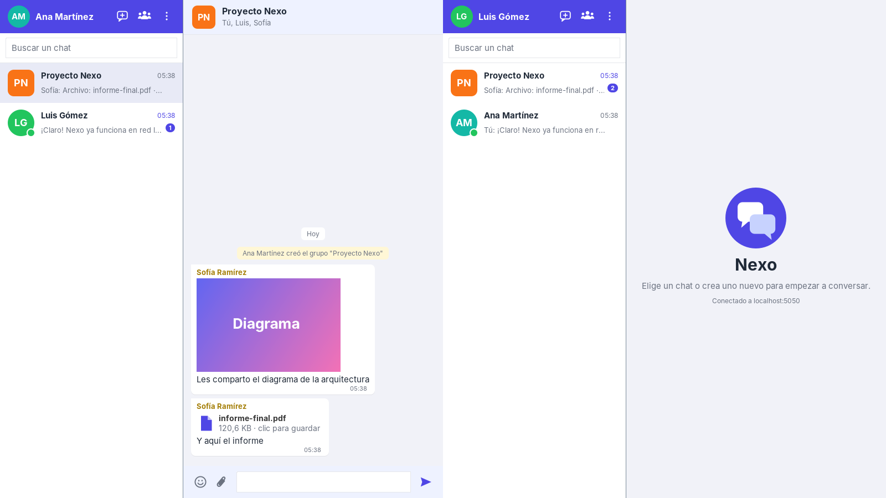

# Nexo 💬

**Nexo** es una aplicación de mensajería instantánea de escritorio hecha **100 % en Java**
(Java 17+, Swing y sockets TCP), sin librerías externas ni bases de datos que instalar.
Se inspira en las apps de chat modernas, con nombre y diseño propios.



## Funciones

- Registro e inicio de sesión (contraseñas guardadas con SHA-256 + sal).
- Chats individuales y **grupos**.
- Mensajes en tiempo real entre varios PCs de la misma red.
- Estados de mensaje: ✓ enviado, ✓✓ entregado, ✓✓ en azul leído.
- "En línea", "últ. vez hoy a las…" y "escribiendo…".
- Envío de **imágenes** (con vista previa) y **archivos** (hasta 8 MB), también arrastrándolos al chat.
- Selector de **emojis**.
- **Foto de perfil**, nombre visible e info editables.
- Contador de no leídos, búsqueda de chats, separadores "Hoy/Ayer", aviso sonoro y
  notificación de escritorio cuando la ventana no está activa.
- Historial guardado en el servidor (`nexo-data/nexo.db`): sobrevive a reinicios.

## Requisitos

Ninguno: basta con descargar el repositorio.

- Si el PC ya tiene **Java 17 o superior**, se usa ese.
- Si no lo tiene, `run.bat` / `run.sh` descargan automáticamente un Java 17 portable
  (Eclipse Temurin) dentro de la carpeta `.jdk` del proyecto. Solo pasa la primera vez,
  necesita internet y **no instala nada** en el sistema.

## Cómo ejecutarlo

```bash
git clone https://github.com/DanielC842/Whatsapp-Clone.git
cd Whatsapp-Clone
```

| Quiero... | Windows | Linux / macOS |
|---|---|---|
| Abrir el lanzador con todas las opciones | doble clic en `run.bat` | `./run.sh` |
| **Demo en un solo PC** (servidor + Ana y Luis) | doble clic en `demo.bat` | `./run.sh demo` |
| Solo el servidor (consola) | doble clic en `servidor.bat` | `./run.sh server` |
| Conectarme a otro PC | `run.bat client 192.168.1.10 5050` | `./run.sh client 192.168.1.10 5050` |

Los scripts compilan el código con `javac` y lo ejecutan; no hace falta Maven ni un IDE.
Si prefieres un IDE (NetBeans, IntelliJ, Eclipse), abre la carpeta como proyecto Maven
(`pom.xml`) y ejecuta la clase `com.nexo.Main`.

### Demo simplificada por consola

En la carpeta [`demo-consola/`](demo-consola/README.md) hay una versión mínima del chat con
solo tres clases (`Servidor`, `Usuario1` y `Usuario2`) que se ejecutan con **Run File** en
NetBeans y chatean por la consola.

### Usuarios de ejemplo

La primera vez que arranca, el servidor crea estos usuarios (contraseña `1234`):
`ana`, `luis` y `sofia`, con un chat y un grupo de ejemplo. También puedes registrar usuarios nuevos.
Para empezar de cero borra la carpeta `nexo-data/`.

### En varios PCs (red local)

1. En el PC servidor abre `run.bat` → **Ser el servidor y entrar** (o `servidor.bat`).
   La consola muestra la IP a la que deben conectarse los demás (ej. `192.168.1.10:5050`).
2. Si Windows pregunta por el Firewall, permite el acceso en **redes privadas**.
3. En los otros PCs abre `run.bat` → **Conectarme a un servidor** y escribe esa IP.

## Estructura

```
src/main/java/com/nexo/
├── Main.java              Lanzador (demo / servidor / cliente)
├── common/                Modelo y protocolo compartido (Packet, Chat, ChatMessage...)
├── server/                NexoServer, ClientHandler, Database (persistencia), User
└── client/                Conexión y estado del cliente
    └── ui/                Interfaz Swing (LoginFrame, MainFrame, ChatView, burbujas...)
```

Cliente y servidor se comunican con objetos `Packet` serializados sobre TCP (puerto 5050).
Más detalles en [`docs/`](docs/): instalación, arquitectura y guion de la presentación.
