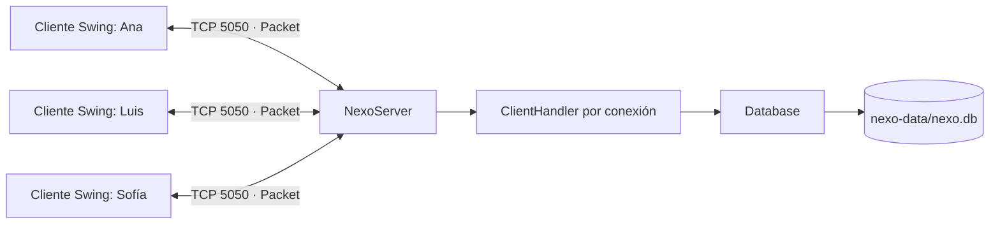
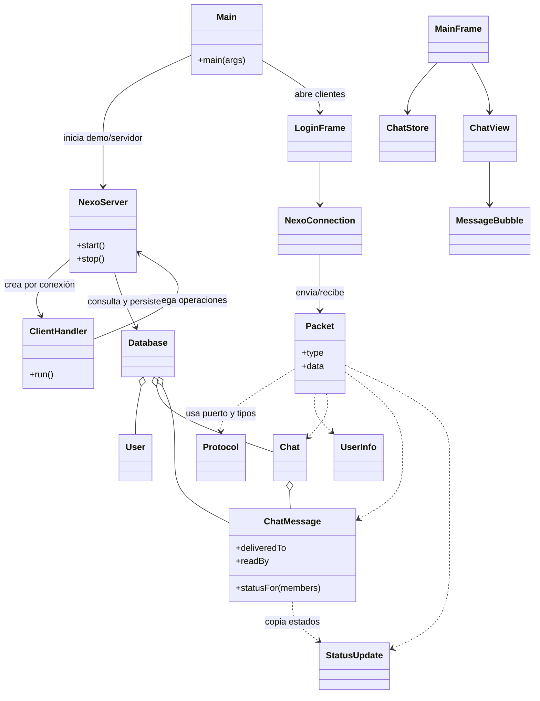

# Arquitectura de Nexo

Nexo es una aplicación Java de escritorio con clientes Swing que se comunican con un servidor central mediante TCP.

## Vista cliente-servidor

Cada cliente mantiene una conexión TCP con el servidor. El servidor crea un `ClientHandler` por conexión, procesa los paquetes y distribuye actualizaciones a los participantes. La base de datos se guarda en el equipo servidor.

## Clases principales

`Packet`, `UserInfo`, `Chat`, `ChatMessage`, `StatusUpdate` y `Protocol` pertenecen a `com.nexo.common`. `NexoServer`, `ClientHandler`, `Database` y `User` pertenecen a `com.nexo.server`. `NexoConnection` y `ChatStore` mantienen la comunicación y el estado local del cliente; las clases Swing de `com.nexo.client.ui` muestran las pantallas y conversaciones.

## Tipos de paquete

Las claves son entradas del mapa `data` de `Packet`. Las listas y objetos se transfieren como objetos serializados compatibles.

| Dirección | Tipo | Claves del mapa `data` | Propósito |
| --- | --- | --- | --- |
| Cliente → servidor | `REGISTER` | `username`, `password`, `displayName` | Registrar cuenta y, si las credenciales son válidas, iniciar sesión. |
| Cliente → servidor | `LOGIN` | `username`, `password`, `displayName` | Autenticar al usuario. `displayName` se envía desde el formulario aunque el servidor no lo usa para el login. |
| Cliente → servidor | `LOGOUT` | — | Cerrar la sesión y conexión. |
| Cliente → servidor | `CREATE_DIRECT` | `username` | Abrir o crear chat directo con ese usuario. |
| Cliente → servidor | `CREATE_GROUP` | `name`, `members` | Crear grupo con nombre y lista de usuarios seleccionados. |
| Cliente → servidor | `SEND_MESSAGE` | `chatId`, `text`; opcionales `fileName`, `fileData`, `image` | Enviar texto, adjunto o ambos. Admite archivos de hasta 8 MiB. |
| Cliente → servidor | `MARK_READ` | `chatId` | Marcar como leídos los mensajes ajenos de ese chat. |
| Cliente → servidor | `TYPING` | `chatId`, `typing` | Activar o retirar el indicador de escritura. |
| Cliente → servidor | `UPDATE_PROFILE` | `displayName`, `about` | Actualizar nombre visible e información. |
| Servidor → cliente | `LOGIN_OK` | `me`, `users`, `chats`, `messages` | Confirmar acceso y enviar estado inicial de la cuenta. |
| Servidor → cliente | `ERROR` | `message` | Informar motivo de error, como credenciales inválidas. |
| Servidor → cliente | `USER_UPDATE` | `user` | Difundir información o presencia actualizada de un usuario. |
| Servidor → cliente | `CHAT_UPDATE` | `chat`, `openFor` | Difundir el chat creado; `openFor` identifica a quién debe abrirse. |
| Servidor → cliente | `NEW_MESSAGE` | `message` | Entregar el mensaje nuevo a los miembros conectados. |
| Servidor → cliente | `STATUS_UPDATE` | `updates` | Enviar lista de cambios, cada uno con `chatId`, `messageId`, `deliveredTo`, `readBy`. |
| Servidor → cliente | `TYPING_EVENT` | `chatId`, `user`, `typing` | Difundir el estado de escritura a los demás participantes. |

Los paquetes se serializan como objetos Java y se transportan por TCP, por defecto en el puerto 5050. Cliente y servidor deben usar las mismas clases compartidas y una versión compatible del protocolo. No se deben deserializar paquetes de fuentes no confiables.

## Persistencia

La implementación guarda usuarios, chats y mensajes en `nexo-data/nexo.db` mediante serialización Java. Se crea el directorio cuando hace falta y cada cambio se escribe a un archivo temporal antes de reemplazar la base. El archivo vive en el equipo servidor, por lo que debe protegerse como cualquier dato privado y respaldarse con el servidor detenido. Las contraseñas se verifican con hash SHA-256 y salt por usuario; no se guardan en texto plano.

## Estados de mensaje

La interfaz representa tres etapas: **enviado** (`✓`), **entregado** (`✓✓`) y **leído** (`✓✓` en azul). Al guardar un mensaje, el servidor registra como entregado a cada miembro que esté conectado y envía `NEW_MESSAGE`. Cuando un usuario inicia sesión, los mensajes pendientes para esa persona también se registran como entregados. Al abrir un chat con mensajes sin leer, el cliente envía `MARK_READ`; el servidor agrega al usuario a `readBy` y difunde `STATUS_UPDATE`. `ChatMessage.statusFor(members)` calcula el estado para el remitente: leído cuando todos los demás miembros están en `readBy`, entregado cuando todos están en `deliveredTo` o `readBy`, y enviado en los demás casos. Los estados reflejan confirmaciones del servidor; no garantizan que la persona haya comprendido el contenido.

Los campos de la tabla se contrastaron con `ClientHandler`, `NexoServer` y el cliente.
